<!--
  Your profile README. Everything outside the profilescape markers is yours to edit.
  Everything between the markers is rewritten by .github/workflows/profilescape.yml.
-->

### Hi, I'm VIRENDER BHAMBRA
A software developer passionate about building practical, scalable, and reliable applications. I primarily work with Java, Spring Boot, React, and PostgreSQL, with an interest in backend engineering and system design.

💻 What I Work With

Backend: Java, Spring Boot, Spring Security, REST APIs

Frontend: React, JavaScript, HTML, CSS

Database: PostgreSQL, SQL, Database Optimization

Infrastructure: Linux, Nginx, Apache Tomcat

🚀 What I'm Exploring

Designing scalable and maintainable software architectures

Advanced Spring Boot and Spring Security

System Design and Performance Optimization

Infrastructure Automation and DevOps

AI-powered application development

🎯 My Approach

I believe in understanding the fundamentals behind technologies, writing maintainable code, and building solutions that work reliably in real-world production environments.

Always learning, building, and exploring better ways to engineer software.

Reach me at 3940virenderbhambra@gmail.com

📄 Resume: [View My Resume](https://your-resume-link-here)

<!-- profilescape:start -->

<picture>
  <source media="(prefers-color-scheme: dark)" srcset="https://raw.githubusercontent.com/VirenderBhambra/VirenderBhambra/profilescape-output/hero-dark.svg" />
  
</picture>

<picture>
  <source media="(prefers-color-scheme: dark)" srcset="https://raw.githubusercontent.com/VirenderBhambra/VirenderBhambra/profilescape-output/stats-dark.svg" />
  
</picture>

<picture>
  <source media="(prefers-color-scheme: dark)" srcset="https://raw.githubusercontent.com/VirenderBhambra/VirenderBhambra/profilescape-output/3d-dark.svg" />
  
</picture>

<picture>
  <source media="(prefers-color-scheme: dark)" srcset="https://raw.githubusercontent.com/VirenderBhambra/VirenderBhambra/profilescape-output/languages-dark.svg" />
  
</picture>

<table>
  <tr>
    <td width="50%">
<a href="https://github.com/VirenderBhambra/virtual-machines-configuration-using-ansible">
<picture>
  <source media="(prefers-color-scheme: dark)" srcset="https://raw.githubusercontent.com/VirenderBhambra/VirenderBhambra/profilescape-output/repo-virenderbhambra-virtual-machines-configuration-using-ansible-dark.svg" />
  
</picture>
</a>
    </td>
    <td width="50%">
<a href="https://github.com/VirenderBhambra/Blog-Application-Express-Server">
<picture>
  <source media="(prefers-color-scheme: dark)" srcset="https://raw.githubusercontent.com/VirenderBhambra/VirenderBhambra/profilescape-output/repo-virenderbhambra-blog-application-express-server-dark.svg" />
  
</picture>
</a>
    </td>
  </tr>
</table>

<table>
  <tr>
    <td width="50%">
<a href="https://github.com/VirenderBhambra/Blog-Application-NextJs-Client">
<picture>
  <source media="(prefers-color-scheme: dark)" srcset="https://raw.githubusercontent.com/VirenderBhambra/VirenderBhambra/profilescape-output/repo-virenderbhambra-blog-application-nextjs-client-dark.svg" />
  
</picture>
</a>
    </td>
    <td width="50%">
<a href="https://github.com/VirenderBhambra/postgres16-and-pgAdmin-docker-configuration-setup">
<picture>
  <source media="(prefers-color-scheme: dark)" srcset="https://raw.githubusercontent.com/VirenderBhambra/VirenderBhambra/profilescape-output/repo-virenderbhambra-postgres16-and-pgadmin-docker-configuration-setup-dark.svg" />
  
</picture>
</a>
    </td>
  </tr>
</table>

<a href="https://github.com/VirenderBhambra">
<picture>
  <source media="(prefers-color-scheme: dark)" srcset="https://raw.githubusercontent.com/VirenderBhambra/VirenderBhambra/profilescape-output/social-github-dark.svg" />
  
</picture>
</a>

